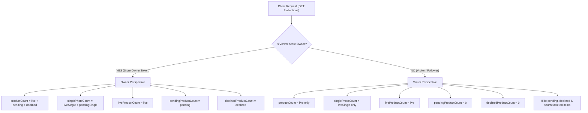

# Project C Catalog — Collection Counter Synchronization & Request Cancellation

## 1. Overview & Context

This document details the architectural fix, schema extensions, and API contract updates for **Quick Import Collection Counters** and **Import Request Cancellation** in the Bullionare Catalog subsystem (`/v1/catalog`).

### The Bug / Gap Addressed
When a destination store imported standard photos alongside exclusive (source-locked) photos:
- Unlocked photos were imported as `importStatus: 'live'`.
- Locked photos were imported as `importStatus: 'pending'`, awaiting approval from the source store.

**The Mismatch**:
- In the **Product Feed** (`GET /stores/:storeId/products?collectionId=:id`), the store owner saw all **4 items** (2 live + 2 pending).
- In the **Collections Endpoints** (`GET /stores/:storeId/collections` and `GET /stores/:storeId/collections/:id`), `productCount` returned only live items (0, 1, or 2), completely ignoring pending items.
- The UI collection badge showed "2", but tapping it opened a product grid containing 4 items, creating an apparent state inconsistency.

Furthermore, if an owner deleted a pending or declined item, the collection counter decremented unconditionally, pushing live product counts below zero or under-counting live stock.

---

## 2. Core Architecture & Design Decisions

### 2.1 Owner View vs. Visitor View Isolation
The API enforces strict identity-aware counter projections based on who is querying:



1. **Store Owner (Own-Store Token)**:
   - `productCount` counts **every non-deleted product** in that collection:
     $$\text{productCount} = \text{liveProductCount} + \text{pendingProductCount} + \text{declinedProductCount}$$
   - **Guaranteed Invariant**:
     $$\text{collection.productCount} \equiv \text{items length of } \texttt{GET .../products?collectionId=:id}$$
   - Detailed breakdown fields are explicitly exposed (`liveProductCount`, `pendingProductCount`, `declinedProductCount`).
2. **Public Visitors & Followers**:
   - `productCount` strictly counts **live products only**.
   - `pendingProductCount` and `declinedProductCount` are `0`.
   - In `GET /collections/:collectionId`, the embedded `products` array strictly filters out `pending`, `declined`, and `sourceDeleted` items, guaranteeing zero privacy leakage.

### 2.2 Retention of Declined Products
When the source store declines an exclusive photo request:
- The product **does not disappear silently** from the destination store.
- It remains visible **only to the destination owner** with `importStatus: 'declined'`.
- This ensures the merchant has full awareness of which items were rejected.
- The item is removed only when the owner manually deletes it via `DELETE /products/:productId`.
- Public visitors never see declined items.

### 2.3 Likes & Views Isolation
- `viewCount` and `likeCount` represent **live engagement only**.
- Pending and declined items have zero views and zero likes.
- When an imported item is approved, it **starts fresh with 0 likes and 0 views**; it never inherits historical engagement counts from the source store.

---

## 3. Detailed Fixes Implemented

### Fix 1: Schema Extension (`models/catalogCollectionModel.js`)
Added dedicated counter fields to `CatalogCollection`:
```javascript
productCount: { type: Number, default: 0 },
subCollectionCount: { type: Number, default: 0 },
singlePhotoCount: { type: Number, default: 0 },
pendingProductCount: { type: Number, default: 0 },
pendingSinglePhotoCount: { type: Number, default: 0 },
declinedProductCount: { type: Number, default: 0 },
```

### Fix 2: Write Layer Counter Mutation (`services/catalogProductService.js`)
- **On Import (`importProductsBatch`)**:
  - Live items: `$inc: { productCount: 1, singlePhotoCount: 1 }`
  - Pending items: `$inc: { pendingProductCount: 1, pendingSinglePhotoCount: 1 }`
- **On Decision (`decideImportRequest`)**:
  - Approved items: `$inc: { pendingProductCount: -1, pendingSinglePhotoCount: -1, productCount: 1, singlePhotoCount: 1 }`
  - Declined items: `$inc: { pendingProductCount: -1, pendingSinglePhotoCount: -1, declinedProductCount: 1 }`
- **On Safe Delete (`deleteProduct`)**:
  - If `product.importStatus === 'pending'`: decrements `pendingProductCount`
  - If `product.importStatus === 'declined'`: decrements `declinedProductCount`
  - If `product.importStatus === 'live'` or `'original'`: decrements `productCount`
  - Live counts are completely insulated from pending/declined deletions.

### Fix 3: Read Layer Projections (`services/catalogCollectionService.js`)
- `list()` and `get()` dynamically compute:
  - If `isStoreOwner`: `productCount = live + pending + declined`
  - If visitor: `productCount = live`
- In `get()`, non-owners are strictly constrained to:
  ```javascript
  if (!isStoreOwner) {
    productFilter.sourceDeleted = { $ne: true };
    productFilter.importStatus = { $in: ['original', 'live'] };
  }
  ```

---

## 4. API Reference

### 4.1 List Store Collections
```http
GET /v1/catalog/stores/:storeId/collections
```

#### Headers
| Header | Type | Description |
| :--- | :--- | :--- |
| `Authorization` | `Bearer <token>` | Optional for public stores; required for owner perspective. |

#### Response — Store Owner Perspective (`isOwner: true`)
```json
{
  "collections": [
    {
      "id": "6720d5c0e1234567890abcde",
      "name": "Bridal Necklaces",
      "description": "Exclusive bridal jewelry collection",
      "privacy": "public",
      "productCount": 4,
      "singlePhotoCount": 4,
      "liveProductCount": 2,
      "pendingProductCount": 2,
      "declinedProductCount": 0,
      "likeCount": 15,
      "viewCount": 120,
      "cover": {
        "url": "https://cdn.example.invalid/thumb_img_1.jpg",
        "thumbhash": "1QcSHQR3d3eHh4eHh4eHh4eH"
      }
    }
  ],
  "hasMore": false,
  "nextCursor": null,
  "total": 1
}
```

#### Response — Visitor Perspective (`isOwner: false`)
```json
{
  "collections": [
    {
      "id": "6720d5c0e1234567890abcde",
      "name": "Bridal Necklaces",
      "description": "Exclusive bridal jewelry collection",
      "privacy": "public",
      "productCount": 2,
      "singlePhotoCount": 2,
      "liveProductCount": 2,
      "pendingProductCount": 0,
      "declinedProductCount": 0,
      "likeCount": 15,
      "viewCount": 120,
      "cover": {
        "url": "https://cdn.example.invalid/thumb_img_1.jpg",
        "thumbhash": "1QcSHQR3d3eHh4eHh4eHh4eH"
      }
    }
  ],
  "hasMore": false,
  "nextCursor": null,
  "total": 1
}
```

---

### 4.2 Get Collection Detail
```http
GET /v1/catalog/stores/:storeId/collections/:collectionId
```

- When viewed by the **Store Owner**: Returns complete collection metadata (`productCount: 4`, `liveProductCount: 2`, `pendingProductCount: 2`) and all products (live, pending, and declined).
- When viewed by a **Public Visitor / Follower**: Returns live-only metadata (`productCount: 2`, `pendingProductCount: 0`) and the embedded `products` array contains only live products.

---

### 4.3 Cancel Pending Import Request (NEW API)
Allows a requester store owner to cancel an outstanding import request before the source store decides on it.

```http
DELETE /v1/catalog/stores/:storeId/import-requests/:requestId
POST   /v1/catalog/stores/:storeId/import-requests/:requestId/cancel
```

#### Authorization
- Authenticated store owner or member token of `storeId` (`requesterStore`).

#### Behavior
1. Validates that the request belongs to `storeId` and has `status: 'pending'`.
2. Sets `status: 'cancelled'`, records `decidedAt: new Date()`.
3. Soft-deletes pending created product copies (`deletedAt: new Date()`).
4. Atomically decrements `pendingProductCount` and `pendingSinglePhotoCount` on the destination collection.

#### Response (`200 OK`)
```json
{
  "success": true,
  "message": "Import request cancelled successfully",
  "requestId": "6720e1a0b1234567890fedcb",
  "status": "cancelled"
}
```

#### Error Responses
- `400 CANNOT_CANCEL_REQUEST`: When request is already approved, declined, or cancelled.
- `404 REQUEST_NOT_FOUND`: When request does not exist or does not belong to `storeId`.

---

### 4.4 Delete Product (Declined / Pending / Live)
```http
DELETE /v1/catalog/products/:productId
```

- Safely deletes any product (including declined items).
- Automatically routes the counter decrement to the appropriate bucket (`productCount`, `pendingProductCount`, or `declinedProductCount`), preventing any counter corruption.

---

## 5. Lifecycle State Matrix & Acceptance Verification

| State / Action | Store Owner `productCount` | Owner `live` | Owner `pending` | Owner `declined` | Visitor `productCount` | `/products?collectionId` Length |
| :--- | :--- | :--- | :--- | :--- | :--- | :--- |
| **1. Import 2 live + 2 locked** | **4** | 2 | 2 | 0 | **2** | **4** |
| **2. Approve 1 pending item** | **4** | 3 | 1 | 0 | **3** | **4** |
| **3. Decline 1 pending item** | **4** | 3 | 0 | 1 | **3** | **4** |
| **4. Owner deletes declined item** | **3** | 3 | 0 | 0 | **3** | **3** |
| **5. Re-import 1 locked photo** | **4** | 3 | 1 | 0 | **3** | **4** |
| **6. Cancel pending import request**| **3** | 3 | 0 | 0 | **3** | **3** |

At every state, for the store owner:
$$\texttt{collection.productCount} \equiv \texttt{products.length returned by /products?collectionId}$$

---

## 6. Frontend Integration Recommendations

1. **Collection Badges**:
   - The badge on collection cards should simply render `collection.productCount`.
   - For store owners, this will accurately match the number of product cards seen upon entering the collection.
2. **Pending Item Tagging**:
   - Inside the collection product grid, products with `importStatus === 'pending'` should display a "Pending Approval" pill.
   - Products with `importStatus === 'declined'` should display a "Declined by Partner" pill with a "Delete" button.
3. **Breakdown Labels (Optional)**:
   - If the store owner UI wants to show an informative header:
     ```javascript
     const subtitle = `${collection.liveProductCount} live • ${collection.pendingProductCount} pending`;
     ```
   - These fields are directly available in both the collection list and detail responses.
